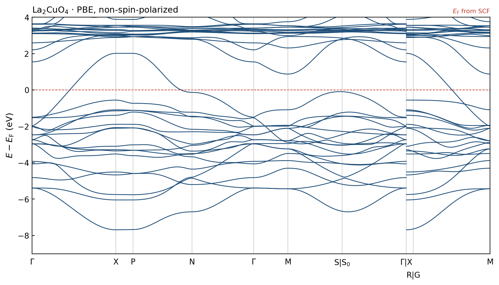
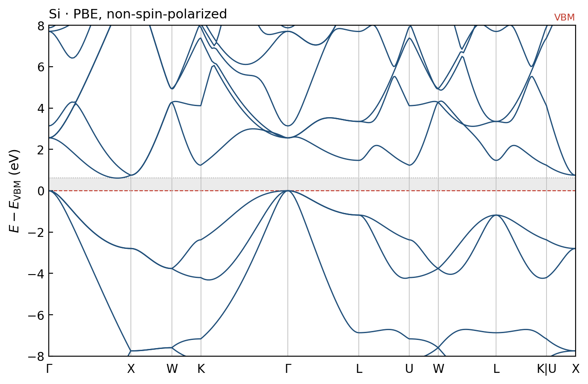
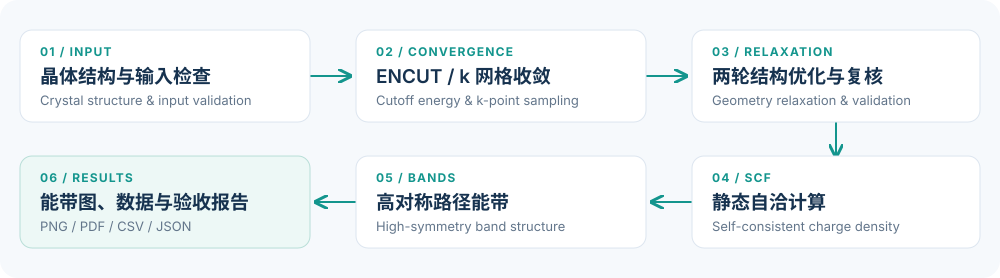

# VASP Band Agent — Automated Band Structure Calculations

**An AI-assisted Python workflow for automated VASP electronic band structure calculations.** Start from a crystal structure and run convergence tests, geometry relaxation, SCF and high-symmetry band calculations, then export band plots, numerical data and validation reports.

[中文](README.md) · [Documentation](docs/README.md) · [AI workflow guide](docs/guides/AI_USAGE.md) · [La₂CuO₄ / Si examples](examples/results/README.md)



*An existing La₂CuO₄ calculation: 360 k points, 64 bands, a custom Hinuma path, and energies referenced to the SCF Fermi level. This nonmagnetic PBE calculation is metallic and excludes antiferromagnetism and DFT+U. [Data and calculation details](examples/results/README.md#la2cuo4).*

<details>
<summary>Silicon PBE validation example</summary>



The Si plot uses the VBM as its energy reference; the sampled-path indirect gap is 0.6104 eV. [Data and provenance](examples/results/README.md#silicon).

</details>

## Workflow



- Validate structures, pseudopotential order and generated inputs.
- Test cutoff energies and k meshes, then validate forces and stresses after relaxation.
- Generate automatic or custom band paths and run fixed-charge bands with `ICHARG=11`.
- Prepare, deploy, submit, monitor and retrieve calculations through SSH and Slurm.
- Use natural-language requests to prepare tasks, review evidence and explain results.
- Keep input hashes, checkpoints and validation reports for auditable execution.

The AI orchestrates tools and reviews evidence; deterministic Python code enforces numerical acceptance. **New full-workflow tasks require operator confirmation, stage review and explicit submission authorization.** The four stages are convergence, relaxation, SCF and bands.

## Quick start

Python 3.11+ is required. Real calculations require your own licensed VASP installation and legally available PBE POTCAR files. Neither is distributed here. AI chat also requires a configured model API; compute nodes do not need model API credentials.

```bash
git clone https://github.com/jiafanlearner/vasp-band-agent.git
cd vasp-band-agent
python -m venv .venv
source .venv/bin/activate
# Windows PowerShell: .venv\Scripts\Activate.ps1
python -m pip install -e ".[ai,ssh]"

# Preview only: no VASP executable, POTCAR or API key needed
python vasp_band_agent.py prepare examples/Si.POSCAR runs/si-preview
python vasp_band_agent.py status runs/si-preview
```

For chat, copy `.env.example` to `.env`, fill in API credentials locally, configure your model in `models.toml`, then start:

```bash
python ai_agent.py --workspace . --profile official
```

Example request:

> Prepare a nonmagnetic PBE silicon band structure calculation from examples/Si.POSCAR on my Slurm cluster. Check the VASP environment and pseudopotentials, compare convergence plans, explain the inputs, and wait before submission.

Configure SSH and the compute environment with `/setup-server <name>`. Confirm the physical model with `/physics`, review each stage and explicitly request its submission. Follow the [AI guide](docs/guides/AI_USAGE.md) for the full sequence. The interface and detailed guides currently focus on Chinese.

## Results and scope

Outputs include `bands.png`, `bands.pdf`, `bands.csv`, `report.json`, convergence records, relaxation validation and the final structure.

The built-in workflow supports nonmagnetic, neutral, ordered PBE structures: 3D bulk and 2D slabs with vacuum along c. Slabs require a single k point along the vacuum direction and use in-plane band paths. Magnetic, SOC, DFT+U, hybrid-functional, phonon and Wannier workflows are outside the current built-in band workflow.

Band gaps describe the sampled path; PBE gaps are not experimental quasiparticle gaps. Relaxation convergence does not establish dynamical stability.

## Development

```bash
python -m pip install -e ".[ai,ssh,test]"
python -m pytest -q
```

Application code: `src/vasp_agent/`. Offline tests: `tests/`. Keep API keys, SSH configuration, private keys, pseudopotentials, sessions and calculation workspaces local. Historical documentation has been sanitized; old task states are dated records.

Initial publication check (2026-11-18, Windows / Python 3.12): **1764 passed, 2 skipped**. Editable installation and the no-POTCAR input preview were also verified. No new VASP calculation was run for this publication.
