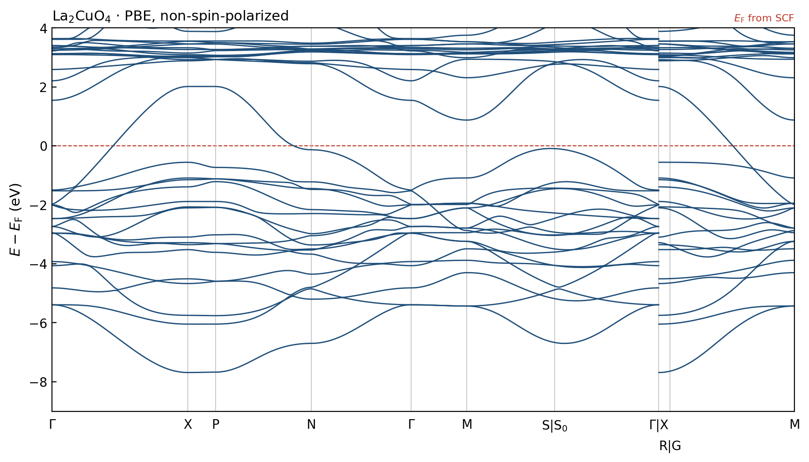
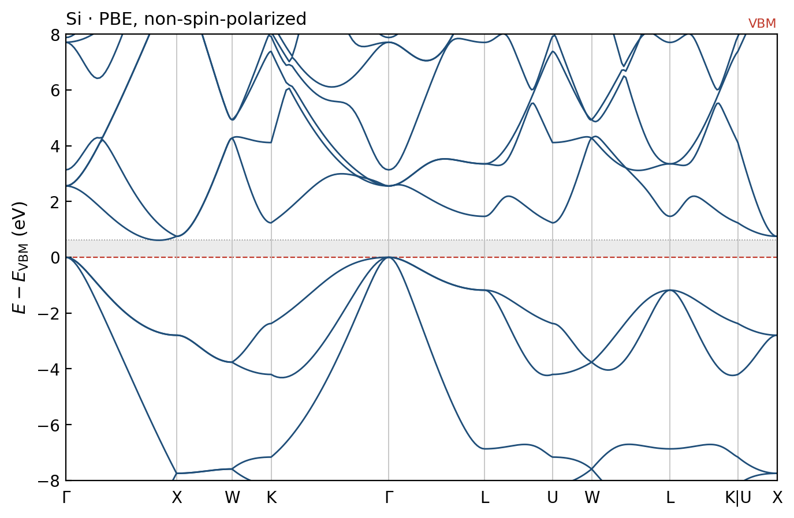
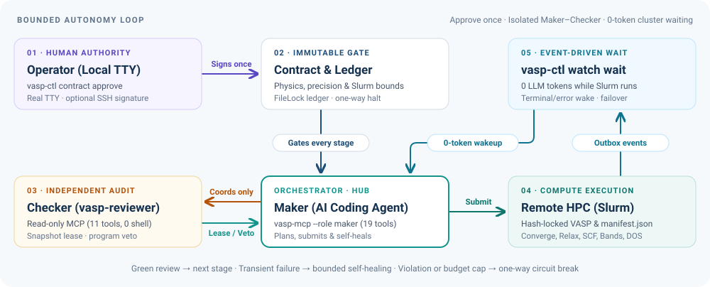
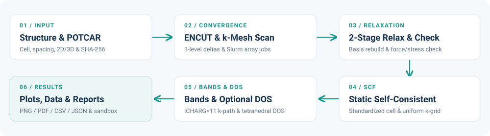

# VASP Band Agent

**Bounded autonomous DFT band-structure & 3D DOS workflows for VASP — AI plans, audits, and self-heals; deterministic Python enforces hashes, contracts, and scientific acceptance.**

[](https://github.com/jiafanlearner/vasp-band-agent/actions/workflows/ci.yml)


[External Agent Kit (MCP)](integrations/vasp-autonomy/README.md) · [Architecture](docs/ARCHITECTURE.md) · [Band Examples](examples/results/README.md) · [Documentation](docs/README.md) · [Chinese](README.zh-CN.md)

---

> **Approve once in your terminal. Let your AI agent run convergence, relaxation, SCF, bands, and 3D DOS on Slurm — with cryptographic audit trails, independent Maker–Checker reviews, and 0-token cluster waiting.**



*Real VASP output for La₂CuO₄ (360 k-points, 64 bands, custom Hinuma high-symmetry path, referenced to the SCF Fermi level; nonmagnetic PBE metallic baseline without antiferromagnetism or DFT+U — [data & provenance](examples/results/README.md#la2cuo4)).*

<details>
<summary>View Silicon PBE validation example (0.6104 eV indirect gap)</summary>



*Real VASP output for diamond Si referenced to the VBM; sampled-path indirect band gap = 0.6104 eV ([data & provenance](examples/results/README.md#silicon)).*

</details>

---

## Why VASP Band Agent?

Most "LLM + DFT" prototypes hand an agent raw SSH access and hope it neither corrupts `INCAR`s nor double-submits Slurm jobs. **VASP Band Agent** separates **AI judgment** from **deterministic scientific execution** so you can delegate multi-stage HPC workflows without surrendering scientific rigor:

- **Approve Once, Execute Boundedly (Human-Signed Contracts)** — Negotiate physics assumptions, precision ceilings (`max_encut`, `max_kmesh_points`), and Slurm resource envelopes with your agent, then sign an immutable contract **once** in a real local TTY (`vasp-ctl contract approve`, with optional OpenSSH `ssh-keygen -Y verify` signatures). Every submission, retry, and fork is gated by a `FileLock`-protected ledger and a one-way circuit breaker.
- **Zero Rubber-Stamping (Independent Maker–Checker MCP)** — Run dual-role MCP servers (`vasp-mcp --role maker` with 19 tools vs. `--role checker` with 11 strictly read-only tools). An isolated Checker subagent (`vasp-reviewer`, zero write/shell access) audits live stage evidence under 15-minute cryptographic snapshot leases — while deterministic Python `program_failures` hold an **absolute veto** no LLM can override.
- **Hash-Locked, End-to-End Scientific Engine** — Automates **Convergence Scan → 2-Stage Relaxation + High-Precision Validation → SCF → Fixed-Charge Bands (`ICHARG=11`) → Optional 3D DOS**. Every input file, `POTCAR` element order, submission script, and evidence checkpoint is SHA-256 verified (`manifest.json`), with strict acceptance gates on energies, forces, stresses, empty bands, and DOS sampling.
- **Bounded Self-Healing (Not Blind Prompt Loops)** — Reconciles SSH disconnects before retrying (preventing duplicate Slurm jobs), resumes interrupted allocations (`TIMEOUT`/`NODE_FAIL`), performs strictly monotonic convergence re-scans (never silently relaxing tolerances), and applies **Tier ③ solver-only overrides** (9 deterministic numerical tags such as `ALGO`/`AMIX`/`BMIX`/`NELM`/`IBRION`, audited via `incar_solver_diff`) before hard circuit-breaking to a human.
- **0-Token Cluster Waiting & Compact Context** — `vasp-ctl watch wait` blocks silently in pure Python (**0 LLM tokens while Slurm runs**) and wakes your agent automatically on terminal states or consecutive error thresholds, with seamless `observer → owner` OS `FileLock` failover alongside `watch daemon`. Stage-focused projection (`stage_review_view`) keeps routine Checker reviews inline under 24 KB (**0 paging**).
- **Sandboxed Post-Processing** — Replot publication-style bands/DOS deterministically (`bands.png`, `bands.pdf`, `bands.csv`, `report.json`) or run custom analysis scripts inside a network-isolated Docker sandbox (`vasp_sandbox_analysis`).

---

## How Bounded Autonomy Works



### Scientific Pipeline



| Stage | Deterministic Automation & Acceptance Gates |
| --- | --- |
| **Structure & POTCAR** | Inspects lattice, interatomic distances, occupancy, 3D vs. 2D slab vacuum geometry, and PBE `POTCAR` element order / `ENMAX` floor. |
| **Convergence** | 3-level `ENCUT` and k-mesh scans (supports Slurm `array` jobs), enforcing strict energy, force, and stress convergence deltas. |
| **Relaxation** | 2-stage ionic/cell relaxation with basis rebuild plus higher-precision static post-relaxation validation of residual forces and stresses. |
| **SCF & Bands** | Standardized primitive cell + automatic or custom high-symmetry k-path (`seekpath`/Hinuma), uniform SCF followed by fixed-charge `ICHARG=11` bands. |
| **3D DOS (Optional)** | Integrated post-bands stage (`optional_stages=["dos"]`) or DOS-only fork from a passed SCF, with automated k-mesh/smearing/window prechecks. |
| **Delivery & Analysis** | Publication-ready `bands.png` / `bands.pdf`, `bands.csv`, `report.json`, full SHA-256 provenance, and optional Docker-sandboxed custom post-processing. |

---

## Quick Start

Requires **Python 3.11+**. Real DFT runs require your own licensed **VASP** installation and legally obtained **PBE POTCAR** files (not bundled in this repository). Compute nodes never need LLM API keys.

### 1. Install

```bash
git clone https://github.com/jiafanlearner/vasp-band-agent.git
cd vasp-band-agent
python -m venv .venv
source .venv/bin/activate          # Windows PowerShell: .venv\Scripts\Activate.ps1

# Choose the extras you need:
python -m pip install -e ".[mcp,ssh]"      # External agents (Antigravity / Codex / Claude Code)
python -m pip install -e ".[ai,ssh]"       # Built-in interactive AI CLI (vasp-ai)
python -m pip install -e ".[ai,mcp,ssh,test]"  # Everything + offline test suite
```

### 2. Zero-VASP Instant Preview (Works Out of the Box)

Try the deterministic engine immediately without VASP, POTCARs, or API keys:

```bash
python vasp_band_agent.py prepare examples/Si.POSCAR runs/si-preview
python vasp_band_agent.py status runs/si-preview
```

### 3. Drive It Your Way

#### Option A: External AI Agents via MCP & `vasp-ctl` (Recommended)

Plug `vasp-band-agent` directly into **Antigravity**, **Codex**, or any MCP-compatible coding agent using the ready-made integration kit in [`integrations/vasp-autonomy/`](integrations/vasp-autonomy/README.md) (SOP skill, isolated `vasp-reviewer` subagent, and `PreToolUse` guard hook):

```bash
# Inspect dual-role MCP tool whitelists (19 Maker tools / 11 read-only Checker tools)
vasp-mcp --workspace . --role maker --list-tools-json
vasp-mcp --workspace . --role checker --list-tools-json

# Operator out-of-band contract approval in a real local terminal (never exposed to MCP)
vasp-ctl contract show
vasp-ctl contract approve <draft_id>

# Event-driven 0-token blocking wait for Slurm completion or error threshold
vasp-ctl watch wait --server <server> --job-name <job> --phase scf --json
```

#### Option B: Built-in Interactive AI CLI (`vasp-ai`)

Copy `.env.example` to `.env`, add your model API key, configure `models.toml`, and launch:

```bash
python ai_agent.py --workspace . --profile official
```

> *"Prepare a nonmagnetic PBE silicon band-structure calculation from `examples/Si.POSCAR` on my Slurm cluster. Inspect the VASP environment and pseudopotentials, compare ENCUT and k-mesh convergence plans, explain the inputs, and pause before submitting."*

Use `/setup-server <name>` to onboard an SSH/Slurm cluster, `/physics` to confirm the physical model, `/plan` to review scan proposals, and `/watch` to manage background job polling.

---

## Five-Layer Defense-in-Depth

| Layer | Control | What It Guarantees |
| --- | --- | --- |
| **L1** | Remote SHA-256 Hash Chain & Scientific Referee | `manifest.json`, `script_sha256`, `checkpoint.evidence_hashes`, and Tier ③ 9-tag solver allowlist reject any tampered or unreviewed inputs on the cluster. |
| **L2** | Real-TTY Contract Approval + Optional OpenSSH Signatures | `vasp-ctl contract approve/resume/revoke` refuses piped stdin and supports `ssh-keygen -Y verify` cryptographic contract verification. |
| **L3** | Dual-Role MCP & Attested Review Leases | Checker cannot write/submit (`TOOL_NOT_ALLOWED_FOR_ROLE`); Maker cannot self-approve in `maker_checker` mode; 15-minute leases bind `(actor, role, host, model, snapshot)`. |
| **L4** | Host Sandbox & Credential Isolation | Checker runs with zero shell/file-write tools; compute nodes hold zero LLM keys; custom post-processing runs inside Docker only. |
| **L5** | `PreToolUse` Guard Hook | [`autonomy_guard.py`](integrations/vasp-autonomy/hooks/autonomy_guard.py) blocks direct edits to contracts, attestations, `servers/`, `runs/`, `potentials/`, and raw `ssh`/`sbatch`/`scancel` bypasses. |

---

## Scientific Scope & Boundaries

- **Supported today**: Nonmagnetic, charge-neutral, ordered periodic structures with PBE — both **3D bulk** and **2D slabs** (vacuum along **c**, `kz = 1`, in-plane band paths, vacuum preservation).
- **Not yet in the built-in workflow** *(planned for P4)*: Spin-polarized magnetism (`ISPIN=2`), SOC, DFT+U, hybrid functionals (`HSE`), phonons, and Wannier90.
- **Physical caveats**: Reported band gaps apply to the sampled k-path; PBE Kohn–Sham gaps are not experimental quasiparticle gaps; geometric relaxation convergence does not establish dynamical stability.

---

## Development & Documentation

All automated tests run **100% offline** (mocked SSH/Slurm stubs — zero external network or live VASP required) and are verified on every push by GitHub Actions CI:

```bash
# Fast local engineering check (ruff lint + 500/800 LOC gate + remote engine release hash)
python tools/check.py --skip-pytest

# Parallel offline test suite
python -m pytest -n auto --dist loadfile -q --tb=short
```

### Further Reading

- [**External Agent Autonomy Kit (`vasp-mcp` / `vasp-ctl`)**](integrations/vasp-autonomy/README.md) — Setup for Antigravity & Codex, `SKILL.md`, `vasp-reviewer`, and L5 hooks.
- [**System Architecture**](docs/ARCHITECTURE.md) — Four-layer acyclic architecture, remote engine freeze contract, and module interfaces.
- [**Bounded Autonomy Design**](docs/design/EXTERNAL_AGENT_AUTONOMY.md) & [**Layer 4 Cost Optimization**](docs/design/LAYER4_COST_OPTIMIZATION.md) — Contract schema, Maker–Checker attestation protocol, stage-focused projection, and `watch wait` state machine.
- [**Full Documentation Hub (Chinese)**](docs/README.md) — Interactive CLI guides, cluster onboarding, 3D DOS, custom band paths, and Slurm arrays.
