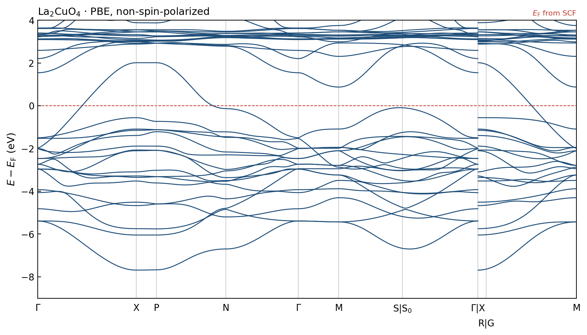
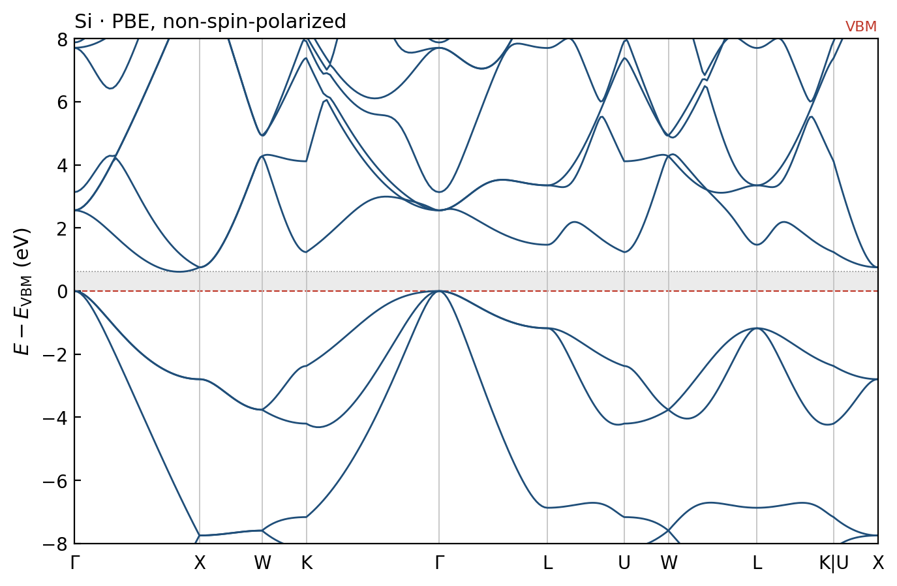
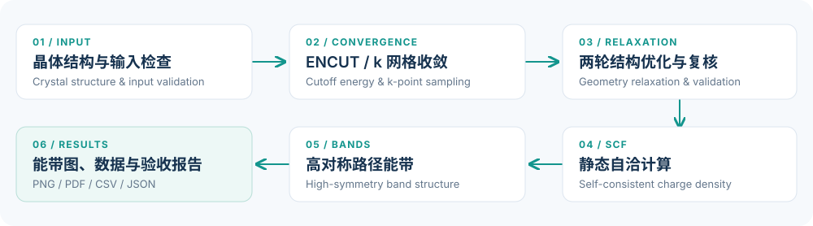

# VASP Band Agent · 有界自治 VASP 能带与态密度计算引擎

**面向 VASP 的有界自治 DFT 能带与三维态密度（DOS）工作流——AI 负责规划、审阅与受控自愈，确定性 Python 引擎守住哈希校验、合同门禁与科学验收底线。**

[](https://github.com/jiafanlearner/vasp-band-agent/actions/workflows/ci.yml)


[English](README.md) · [外部代理接入套件 (MCP)](integrations/vasp-autonomy/README.md) · [架构总览](docs/ARCHITECTURE.md) · [La₂CuO₄ / Si 真实算例](examples/results/README.md) · [文档导航](docs/README.md)

---

> **在本地终端一次签发合同，让 AI 代理自动驱动集群完成 收敛测试 → 结构优化 → SCF → 能带 → 3D DOS —— 全程哈希锁死、独立 Maker–Checker 审阅、作业等待期 0 Token 零空转。**



*La₂CuO₄ 已有真实 VASP 计算结果：360 个 k 点、64 条能带，自定义 Hinuma 路径，以 SCF 费米能为零点。该非磁性 PBE 算例呈金属性，不含反铁磁与 DFT+U（[查看数据与来源哈希](examples/results/README.md#la2cuo4)）。*

<details>
<summary>查看 Si PBE 能带验证示例（间接带隙 0.6104 eV）</summary>



*Si 真实 VASP 算例以 VBM 为能量零点，采样路径间接带隙为 0.6104 eV（[查看数据与说明](examples/results/README.md#silicon)）。*

</details>

---

## 核心特性

- **人类一次签发、有界自治执行**：与代理协商物理模型、精度上限与 Slurm 资源包络后，操作者在本地真实终端执行一次 `vasp-ctl contract approve` 签发不可变合同（支持可选 OpenSSH `ssh-keygen -Y verify` 密码学验签）；后续所有提交、续算与派生修复均受 `FileLock` 账本与单向熔断器约束。
- **独立 Maker–Checker 双角色审阅（拒绝橡皮图章）**：通过双角色 MCP 服务隔离权限（`vasp-mcp --role maker` 19 工具 vs `--role checker` 11 只读工具）；独立只读子代理 `vasp-reviewer`（禁写、禁 Shell）凭 15 分钟快照读回执租约核验实况证据，Python 确定性 `program_failures` 拥有模型无法推翻的一票否决权。
- **端到端科学流水线与哈希锁死**：覆盖 **结构/POTCAR 核验 → ENCUT/k 网格收敛测试（支持 Slurm 数组任务）→ 两轮优化与高精度复核 → SCF → 固定电荷能带（`ICHARG=11`）→ 可选 3D DOS**；全部输入、提交脚本与阶段证据均由 SHA-256 哈希链校验。
- **受控自愈而非盲目重试**：内置 SSH 断连防双交对账、非数组作业中断续算（`TIMEOUT`/`NODE_FAIL`）、严格单调加密重扫（绝不静默放宽阈值），以及仅放开 9 个纯数值求解器标签的 **Tier ③ 求解器覆盖**（经 `incar_solver_diff` 审阅）；越界或达上限自动硬熔断交人工。
- **0-Token 事件驱动等待与精简审阅上下文**：`vasp-ctl watch wait` 在纯 Python 中静默阻塞等待（作业运行期消耗 **0 LLM token**），在终态或连续错误达阈值时自动唤醒，并与 `watch daemon` 实现 `observer → owner` OS `FileLock` 无缝接管；阶段聚焦投影（`stage_review_view`）将常规 Checker 审阅压缩至 24 KB 内直接内联（0 翻页）。
- **Docker 沙箱后处理**：内置确定性出图（`bands.png`/`bands.pdf`/`bands.csv`/`report.json`），自定义分析脚本统一在断网 Docker 沙箱内运行（`vasp_sandbox_analysis`）。

---

## 科学流程



| 阶段 | 自动化内容与确定性验收 |
| --- | --- |
| 结构与赝势 | 检查晶胞、原子间距、占位、3D/2D 真空方向及 PBE `POTCAR` 元素顺序与 `ENMAX` 下限 |
| 精度收敛 | ENCUT 与 k 网格三级扫描（支持 Slurm `array`），校验能量、力与应力收敛差值 |
| 结构优化 | 两轮优化与基组重建，并做更高精度静态复核校验残余力与应力 |
| SCF 与能带 | 标准化原胞与自动/自定义高对称路径，均匀网格 SCF 后用 `ICHARG=11` 计算固定电荷能带 |
| 3D DOS（可选） | 支持流程末尾集成（`optional_stages=["dos"]`）或从已通过 SCF 派生，含 k 网格/展宽/能量窗代码预检 |
| 交付与后处理 | 输出出版级 `bands.png`/`bands.pdf`/`bands.csv`/`report.json`、完整 SHA-256 溯源及 Docker 沙箱分析 |

---

## 快速开始

需要 **Python 3.11+**。真实计算需自备合法的 **VASP** 与 **PBE POTCAR**（本仓库不提供）；计算节点无需模型 API 密钥。

### 1. 安装

```bash
git clone https://github.com/jiafanlearner/vasp-band-agent.git
cd vasp-band-agent
python -m venv .venv
source .venv/bin/activate          # Windows PowerShell: .venv\Scripts\Activate.ps1

python -m pip install -e ".[mcp,ssh]"          # 外部代理接入（Antigravity / Codex / Claude Code）
python -m pip install -e ".[ai,ssh]"           # 内置交互式 AI CLI（vasp-ai）
python -m pip install -e ".[ai,mcp,ssh,test]"  # 完整功能 + 离线测试依赖
```

### 2. 零依赖预览输入（无需 VASP / POTCAR / API 密钥）

```bash
python vasp_band_agent.py prepare examples/Si.POSCAR runs/si-preview
python vasp_band_agent.py status runs/si-preview
```

### 3. 两种 AI 驱动方式

- **方式 A · 外部强代理有界自治（MCP / `vasp-ctl`，推荐）**：按 [外部代理接入套件说明](integrations/vasp-autonomy/README.md) 接入 Antigravity / Codex：
  ```bash
  vasp-mcp --workspace . --role maker --list-tools-json
  vasp-mcp --workspace . --role checker --list-tools-json
  vasp-ctl contract approve <draft_id>
  vasp-ctl watch wait --server <server> --job-name <job> --phase scf --json
  ```
- **方式 B · 内置交互式 AI CLI（`vasp-ai`）**：复制 `.env.example` 为 `.env` 并配置 `models.toml` 后运行 `python ai_agent.py --workspace . --profile official`，使用 `/setup-server`、`/physics`、`/plan`、`/watch` 分阶段推进。详见 [AI 使用说明](docs/guides/AI_USAGE.md) 与 [新集群接入](docs/guides/CLUSTER_ONBOARDING.md)。

---

## 当前支持范围与科学边界

- **当前内置支持**：非磁性、电中性、PBE 有序周期结构；支持 **3D 体相** 与 **2D slab**（真空沿 **c** 轴、`kz = 1`、面内高对称路径）。
- **暂未内置（规划于 P4）**：自旋极化磁性（`ISPIN=2`）、SOC、DFT+U、杂化泛函（HSE）、声子谱与 Wannier90。
- **物理口径提示**：带隙仅覆盖采样高对称路径；PBE 带隙不等同于实验准粒子带隙；结构优化收敛不等同于动力学稳定。

---

## 开发与离线测试

全部自动化测试纯离线运行（强制隔离真实 SSH/VASP），每次推送由 GitHub Actions 云端全量验证：

```bash
python tools/check.py --skip-pytest
python -m pytest -n auto --dist loadfile -q --tb=short
```

更多指南与架构文档请查阅 [文档导航](docs/README.md)、[系统架构总览](docs/ARCHITECTURE.md)、[外部代理有界自治架构设计](docs/design/EXTERNAL_AGENT_AUTONOMY.md) 与 [Layer 4 控制面降本设计](docs/design/LAYER4_COST_OPTIMIZATION.md)。
