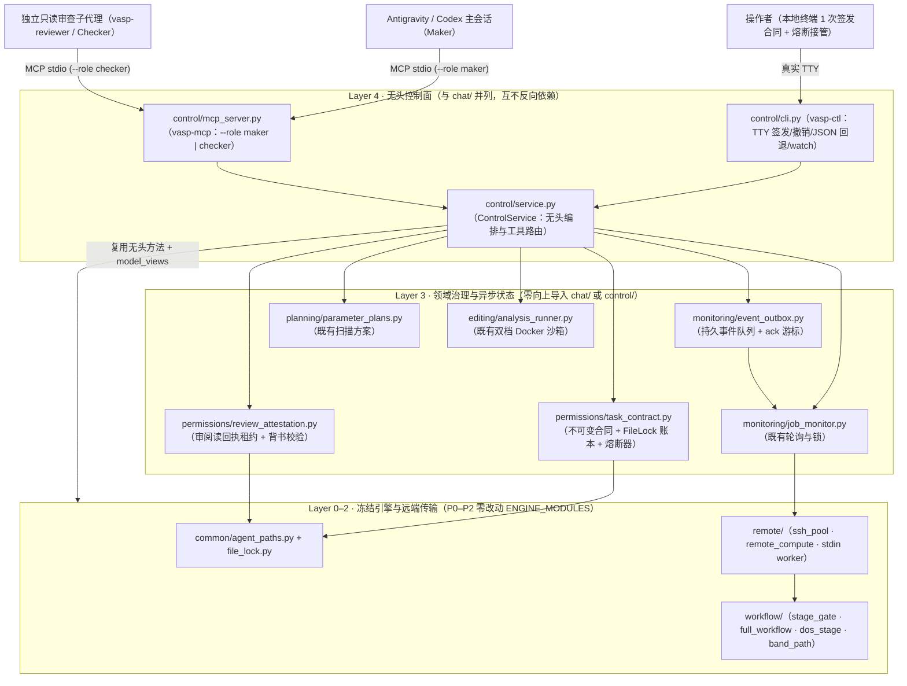
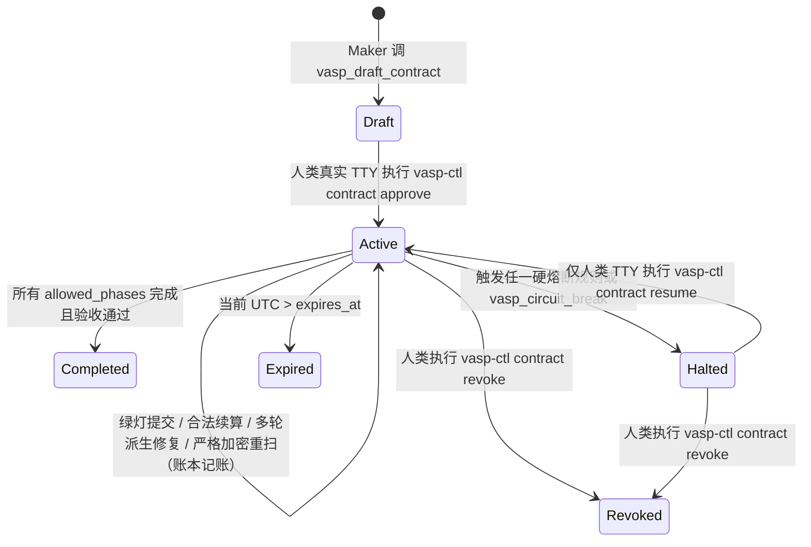
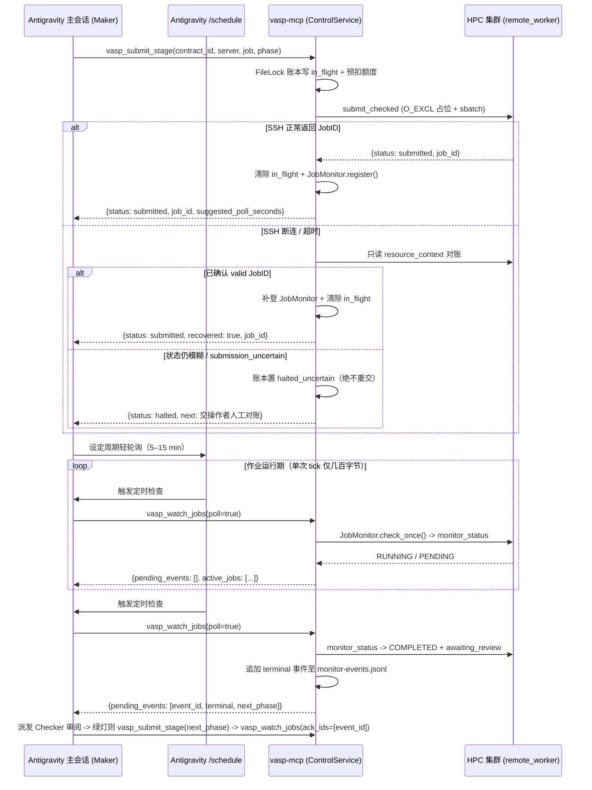

# 外部代理驱动的有界自治架构设计（Antigravity / Codex）

> **文档状态**：P0–P3 已全部实施完成（P3 经授权升级 `ENGINE_MODULES` 24 → 25，需集群执行一次 `remote_deploy`；历史任务继续绑定旧 `releases/c9c11663accd1fce/`）  
> **当前基线**：`main` 分支，远端科学引擎当前版本 `release=5b124e988c010ec8`（P0–P2 历史冻结基线 `c9c11663accd1fce`）  
> **关联文档**：[AGENTS.md](../../AGENTS.md) · [ARCHITECTURE.md](../ARCHITECTURE.md) · [WORKFLOW_MODULES.md](WORKFLOW_MODULES.md) · [chat.md](../modules/chat.md) · [remote.md](../modules/remote.md) · [workflow.md](../modules/workflow.md) · [monitoring.md](../modules/monitoring.md)

---

## 0. 目标与已拍板边界

本设计将 `vasp-band-agent` 演进为**由外部强代理（Antigravity 优先，同时兼容 Codex）驱动并独立审查的有界自治计算引擎**：操作者平时在宿主对话中讨论物理方案并把关 1 次（签发任务自治合同），后续由宿主代理驱动多阶段 VASP 计算、异步轮询、独立只读审查与受合同约束的有限自愈，遇到异常或越界立即硬熔断上报。

**全程强制不变量**：
1. **科学引擎零改动（P0–P2）**：不修改 `remote_worker.ENGINE_MODULES` 与 `WORKER_UNITS` 任一文件，`bundle.local_version()` 维持 `c9c11663accd1fce`，集群无需重新 `remote_deploy`；`confirm_physics` 沿用既有通道 `'operator_slash_command'`。
2. **既有能力零破坏**：完整保留交互式 `vasp-ai` CLI、`PROMPT_TOKEN_BUDGET = 14800`、`.agent/` 运行时路径契约（[agent_paths.py](../../src/vasp_agent/common/agent_paths.py)）以及 `runs/`、`downloads/`、`servers/`、`potentials/`、`workbench/`、`reports/` 等受保护目录。
3. **代码质量守门**：新增 Python 源码全部保持 `<= 500` 行（`tools/check.py` 零警告），跨平台 LF 行尾与 `.as_posix()` 路径；MCP 可选依赖（`mcp>=1.6`，同时声明在 `[mcp]` 与 `[test]` 组）必须延迟导入，确保 [test_project_layout.py](../../tests/test_project_layout.py) 在未装可选依赖时全包可导入。

---

## 1. 架构分层与模块边界

在现有四层无环架构（[ARCHITECTURE.md](../ARCHITECTURE.md)）基础上，新增与 `chat/` 并列的无头接入层 **`control/`（Layer 4）**，并将自治合同、审阅背书与持久事件队列沉淀在 **Layer 3**：



### 1.1 新增/变更模块清单与行数预算

| 层级 | 文件路径 | 职责与边界 | 预计行数 |
|---|---|---|---|
| Layer 4 | `src/vasp_agent/control/__init__.py` | 包导出门面 | <= 20 |
| Layer 4 | `src/vasp_agent/control/service.py` | 共享 `ControlService`：复用 `Toolbox` 无头方法（`plan_reader=None`）、统一 `model_views.model_output()` 压缩与 `.agent/evidence/` 转存、调用合同与背书门禁 | <= 450 |
| Layer 4 | `src/vasp_agent/control/service_healing.py` | 受控自愈编排（P1 拆分，防 `service.py` 超 500 行）：断连对账、`vasp_prepare_resume`、`vasp_prepare_repair_fork`、`vasp_prepare_scan_retry` | <= 380 |
| Layer 4 | `src/vasp_agent/control/mcp_server.py` | 薄 stdio MCP Server（延迟导入 `mcp>=1.6`），按 `--role maker|checker` 暴露受控工具白名单与 JSON Schema；长驻复用 `ssh_pool` | <= 350 |
| Layer 4 | `src/vasp_agent/control/cli.py` | `vasp-ctl` 薄 CLI（零额外依赖）：`contract approve|show|revoke|resume`、`watch once|daemon|ack`、`call --json` | <= 350 |
| Layer 3 | `src/vasp_agent/permissions/task_contract.py` | 合同 Schema 校验、规范哈希、真实 TTY 签发、可选 `ssh-keygen -Y sign/verify` 验签、`FileLock` 账本与熔断器 | <= 450 |
| Layer 3 | `src/vasp_agent/permissions/review_attestation.py` | 审阅快照短期读回执租约、`checker != maker` 校验、结构化远端 `reviewer` 编码与本地背书落盘 | <= 280 |
| Layer 3 | `src/vasp_agent/monitoring/event_outbox.py` | 持久事件队列 `.agent/state/monitor-events.jsonl` 写入、去重与 `ack` 游标（复用 `JobMonitor` 的 `state_lock`） | <= 240 |
| Layer 0 | [agent_paths.py](../../src/vasp_agent/common/agent_paths.py) | 仅向 `STORES` / `FILES` 追加 `contracts`、`review_attestations`、`monitor_events` 键（不改既有任何键与迁移逻辑） | +15 行 |
| 集成包 | `integrations/vasp-autonomy/` | Antigravity 优先插件包 + Codex 兼容配置：`SKILL.md`、`agents/vasp-reviewer.md`、`hooks/autonomy_guard.py`、MCP 配置模板 | 文档/脚本 |

### 1.2 依赖方向与已有组件复用
- **AST 零向上导入守门**：`permissions/task_contract.py`、`permissions/review_attestation.py`、`monitoring/event_outbox.py` 均严禁导入 `vasp_agent.chat` 或 `vasp_agent.control`（由新增单测 AST 强制检查）。
- **复用 `Toolbox` 而不复制逻辑**：`ControlService` 内部持有非交互 `Toolbox(workspace, allow_submit=False)`（`plan_reader=None`、`require_scan_plans=True`），复用 [toolbox_core.py](../../src/vasp_agent/chat/toolbox_core.py) 的脱敏（`scrub_payload`）、审计（`log()`）、证据存储（`store_evidence`）与 [toolbox_workflow.py](../../src/vasp_agent/chat/toolbox_workflow.py) / [toolbox_submission.py](../../src/vasp_agent/chat/toolbox_submission.py) / [toolbox_workspace.py](../../src/vasp_agent/chat/toolbox_workspace.py) 的底层执行路径，并在所有受控写操作前叠加合同/账本/背书校验。
- **上下文体积控制**：所有返回体统一经过 [model_views.py](../../src/vasp_agent/chat/model_views.py) 的 `model_output(name, output, box.store_evidence)`（`vasp_get_stage_review` 先经 `control/stage_review_view.py` 阶段聚焦投影）；超过 `MIN_CHARS=2000` 的大对象自动折叠哈希表/矩阵/长文本并将原文写入 `.agent/evidence/<sha256>.json`，控制面硬限制单次 MCP 响应 `<= 24 KB`（P0–P3 初版为 12 KB，路线 1 提升至 24 KB，超限经 `control/service_overflow.py` 默认转存精简视图 `sha256` 并附原文 `raw_sha256` 供 `vasp_read_evidence` 按 8000 字符/页拉取）。

---

## 2. MCP 工具清单与角色权限矩阵

`vasp-mcp` 启动参数：`vasp-mcp --workspace <path> --role <maker|checker> [--actor-id <id>] [--host <host>] [--model <model>] [--ssh-transport pooled|subprocess] [--list-tools-json]`。

- **签发/撤销合同、取消作业、强制释放回执、删除任务** 等高危或破坏性操作**永不注册到任何 MCP 进程**，仅保留在操作者本地 `vasp-ctl`（或 `vasp-ai` 交互菜单）。
- 首批暴露 **19 个无头工具**（不暴露阻塞式 `request_*` 菜单与冗余的 `workbench_edit` 6 工具）：

| # | MCP 工具名 | `--role maker` | `--role checker` | 底层复用与核心契约 |
|---|---|---|---|---|
| 1 | `vasp_workspace_info` | 只读 | 只读 | `list_files` + `list_servers` + 活动合同摘要 |
| 2 | `vasp_inspect_structure` | 只读 | 只读 | `inspect_structure` + `inspect_potentials`（带 `content_is_untrusted: true`） |
| 3 | `vasp_preview_defaults` | 只读 | 只读 | `preview_scan_defaults`（含可选阶段参数规范与 `guides` 指针） |
| 4 | `vasp_task_status` | 只读 | 只读 | 统一 `remote_status` / `get_status` / `inspect_convergence` |
| 5 | `vasp_read_evidence` | 只读 | 只读 | `read_context_evidence` / `read_stage_guide` / `read_log` 白名单尾部 |
| 6 | `vasp_diagnose_submission` | 只读 | 只读 | `get_submission_diagnostic` + `get_submission_recovery` + `get_submission_resources` |
| 7 | `vasp_contract_status` | 只读 | 只读 | 读取不可变合同摘要、账本已用额度、允许任务列表与熔断原因 |
| 8 | `vasp_get_stage_review` | 只读（签租约） | 只读（签租约） | `get_stage_review` + 为当前 `(actor_id, role, snapshot)` 写短期读回执租约 |
| 9 | `vasp_record_stage_review` | 仅 `maker_direct` 合同允许 | **默认主入口** | 校验读回执与角色 → 调远端 `stage_review` → 落盘本地背书；代码 `program_failures` 一票否决 |
| 10 | `vasp_draft_contract` | 写草案 | 禁止 | 调用 `parameter_plans.propose` + 写 `.agent/state/contracts/drafts/<draft_id>.json`；返回 `vasp-ctl contract approve <draft_id>` 命令 |
| 11 | `vasp_prepare_task` | 合同门控写 | 禁止 | 核验已签合同后执行 `parameter_plans.prepare`（含合同预设 `solver_overrides`）+ `confirm_physics(..., 'operator_task_contract', contract_id, contract_sha256)` + 首阶段 `configure_resources` |
| 12 | `vasp_submit_stage` | 合同门控提交 | 禁止 | 核验合同/预算/资源包络/审阅背书 → 账本预扣 → `configure_resources`（如需）+ `submit_checked` → 登记 `JobMonitor` → 立即返回 `job_id` |
| 13 | `vasp_prepare_resume` | 合同门控自愈 | 禁止 | 原地受限续算（详见 §2.1）：仅限非数组中断态（`TIMEOUT`/`CANCELLED`/`NODE_FAIL`/`PREEMPTED`），归档部分输出、复用已验收阶段、消耗 1 次 `resume_retries`，须重新过审 |
| 14 | `vasp_prepare_repair_fork` | 合同门控自愈 | 禁止 | 多轮诊断与新目录派生修复（详见 §2.1）：覆盖 `array`/Slurm `FAILED`/`OOM`/VASP 报错，以及 P3 新增 `failure_category='incar_solver_convergence'` + Tier ③ `solver_overrides`（受 `solver_policy` 与 Checker `incar_solver_diff` 审阅约束），消耗 1 次 `repair_retries` 并须重新过审；非 Tier ③ INCAR 故障或连续多轮未成功自动熔断交人工 |
| 15 | `vasp_prepare_scan_retry` | 合同门控自愈 | 禁止 | 受限加密重扫（详见 §2.1）：仅向更严方向加密建新目录，严禁放宽阈值或改物理模型，消耗 1 次 `scan_retries`，须重新过审 |
| 16 | `vasp_watch_jobs` | 轮询 + ack | 仅只读查看 | 读取 `.agent/state/monitor-events.jsonl`；Maker 可传 `poll=true` 触发 `JobMonitor.check_once()` 及 `ack_ids` |
| 17 | `vasp_fetch_results` | 写下载目录 | 禁止 | `remote_fetch` + 可选确定性 `analyze_band_results` / `replot_bands` |
| 18 | `vasp_sandbox_analysis` | Docker 沙箱 | 禁止 | 封装 `get_analysis_runtime`、`stage_download_for_analysis`、`validate/run_analysis_script`（`default`/`scientific`、`export_outputs`），不降级宿主机 |
| 19 | `vasp_circuit_break` | 单向熔断 | 单向熔断 | 将合同账本不可逆置为 `halted` 并写入结构化诊断，任何代理无法自解 |

### 2.1 受控自愈工具硬契约（与底层 Worker 能力严格对齐）

1. **断连/提交不明自愈（内建于 `vasp_submit_stage` + `vasp_diagnose_submission`）**：
   - `vasp_submit_stage` 在发起远端 `submit_checked` 前先写账本 `in_flight`；若 SSH 断连或超时，立刻执行只读 `resource_context` 对账（复用 [toolbox_submission.py](../../src/vasp_agent/chat/toolbox_submission.py#L223-L237)）：
     - 远端已存在 `status == 'submitted'` 且 `job_id` 合法 → 自动补登 `JobMonitor`、写入账本并返回已确认 `job_id`；
     - 远端明确无任何 `submissions/<phase>.json` 且 `squeue/sacct`（经 `submission_diagnostic` 窗口检索）确认无对应作业，且合同剩余重试额度允许 → 允许主控代理再发起 1 次安全重试；
     - 远端存在 `submission_pending`/`submission_uncertain` 或 `submission_diagnostic` 发现候选作业/时间窗模糊 → **立即硬熔断（`halted_uncertain`）交人工**，绝不双交。
2. **`vasp_prepare_resume`（Slurm 中断续算，严格遵守 [worker_lifecycle.py](../../src/vasp_agent/remote/worker_lifecycle.py#L167-L338)）**：
   - **前置硬条件**：
     - 合同 `budget.max_resume_retries > ledger.resume_retries_used` 且 `ledger.submissions_used < budget.max_submissions`；
     - 目标作业必须是**非数组模式（`allocation`）**（因 `worker_lifecycle.prepare_phase_resume` 明确拒绝 `array` 模式）；
     - Slurm `sacct` 终态属于 `RESUMABLE_STATES = ('TIMEOUT', 'CANCELLED', 'NODE_FAIL', 'PREEMPTED')`，且 `workflow-state.json` 不为 `failed`；
     - 同一阶段连续失败达到合同 `max_consecutive_failures`（默认 3）立即熔断，禁止死循环。
   - **执行动作**：调用远端 `prepare_phase_resume(job_name, phase, confirm_job_id=job_id)` 归档中断输出并锁定 `checkpoint.json['resume']` → 停用旧 `JobMonitor` 条目 → 允许在 `resource_envelope` 内调整资源（如调大 `walltime <= max_walltime`）→ 账本递增 `resume_retries_used` → 强制重新走 `vasp_get_stage_review` + 审阅放行后才允许 `vasp_submit_stage`。
   - **不满足原地续算条件时的转交**：遇 `array` 模式中断、Slurm `FAILED` / `OUT_OF_MEMORY` 或 `workflow-state == failed`（VASP 报错）时，不越界修改冻结的 `worker_lifecycle.py`，而是由主控代理转入下方 **`vasp_prepare_repair_fork`** 开展多轮有界自检自修，连续多轮未成功再熔断交人工审核。
3. **`vasp_prepare_repair_fork`（多轮自检自修与派生重跑，零改动 `ENGINE_MODULES` / `WORKER_UNITS`）**：
   - **前置硬条件**：
     - 必须先执行 `vasp_diagnose_submission` 与 `vasp_task_status`（必要时 `vasp_read_evidence`），在账本留存结构化诊断记录（`failure_category`、`evidence_sha256`、`repair_hypothesis`、`applied_change`）；
     - 合同 `budget.max_repair_retries > ledger.repair_retries_used`、`ledger.consecutive_failures < budget.max_consecutive_failures` 且 `ledger.submissions_used < budget.max_submissions`；
     - 严格限定在合同 `resource_envelope`、`precision_bounds` 与不可变 `physics_assertion` 内（严禁改物理模型、严禁放宽 `scan_thresholds`、严禁覆写原失败目录）。
   - **零改引擎下的合法自修路径**（全部通过 [fork_naming.py](../../src/vasp_agent/chat/fork_naming.py) 创建新不可变目录 `<job>_fix1` / `_2`）：
     - `convergence` 失败（含 `array` 数组作业部分/全部失败、`OUT_OF_MEMORY`、分区容量冲突或节点均分冲突）：基于合同锁定方案重开干净目录，在 `resource_envelope` 内修复资源（如 `array` → `allocation`、增 `nodes`/降 `parallel_tests`/调 `cores_per_test` 提升单核内存、增 `walltime`、采纳 `diagnosis.resource_layout_candidates`）；
     - 上游已通过而下游（`relaxation` / `scf` / `bands` / `dos`）发生 `FAILED` / `OUT_OF_MEMORY` / 瞬态 VASP 崩溃或空带不足：复用冻结引擎既有派生入口（`prepare_production_from_convergence`、`prepare_bands_path`、`prepare_dos_fork` 或合同内调参重准备）保留已验收上游证据、在新目录应用修复后的资源与合法参数（如 `nbands`）；
     - 自动沿用原合同 `confirm_physics(..., 'operator_task_contract', contract_id, contract_sha256)`，将新目录登记至账本 `allowed_jobs`，递增 `repair_retries_used` 与阶段连续失败计数，**必须重新通过 Checker 审阅**后方可提交。
   - **多轮失败交人工审核（硬熔断出口）**：
     - 达到 `max_repair_retries`（默认 3 轮）或 `max_consecutive_failures`（默认 3 次）或总提交额度耗尽仍未成功 → 自动置 `halted` 并汇总历轮诊断与尝试记录交操作者人工审核；
     - 属 Tier ③ 白名单求解器收敛故障时通过 `failure_category='incar_solver_convergence'` + `solver_overrides` 修复（受 `solver_policy` 与 Checker 审阅 `incar_solver_diff` 约束）；若诊断确认属于 Tier ③ 白名单外的 INCAR 数值/物理标签故障（`incar_numerical_unsupported`），仍立即硬熔断交人工审核。
4. **`vasp_prepare_scan_retry`（收敛未过时的受控加密重扫）**：
   - **前置硬条件**：
     - 经 `inspect_convergence` 确认来源任务 `convergence` 已结束且因收敛阈值未达标而未通过（非硬件崩溃）；
     - 合同 `budget.max_scan_retries > ledger.scan_retries_used` 且 `ledger.submissions_used < budget.max_submissions`；
     - **严格单调更严校验**（由 `task_contract.validate_stricter_retry()` 硬拦截）：
       - 严禁传入任何放宽的 `scan_thresholds`（强制为 `None` 或不宽松于来源）且严禁改动 `scan_preset` 为更松档位、严禁改动物理假设；
       - `mode` 含 `encut` 时：新序列须严格单调递增、最低点 `>= potential_floor`、最高点严格大于来源最高 ENCUT 且 `<= contract.precision_bounds.max_encut`；
       - `mode` 含 `mesh` 时：新网格各分量 `>=` 来源对应网格且最密网格总 k 点数严格大于来源最密网格，单轴 `<= max_kmesh_axis`、总点数 `<= max_kmesh_points`（2D 任务强制 `kz == 1`）。
   - **执行动作**：通过 [fork_naming.py](../../src/vasp_agent/chat/fork_naming.py) 安全分配不冲突新目录名（`<job>_r1` / `_2`，绝不覆盖旧目录）→ 调用远端/本地 `prepare_scan_retry` → 写入与原合同绑定的 `confirm_physics(..., 'operator_task_contract', contract_id, contract_sha256)` 与合同内默认资源 → 将新任务名登记到账本 `allowed_jobs` → 强制重新走审阅后提交；若达到 `precision_bounds` 上限仍不收敛，立即熔断上报。

---

## 3. 任务自治合同 Schema、账本状态机与签发流程

### 3.1 不可变合同与可变账本分离存储
- 草案：`.agent/state/contracts/drafts/<draft_id>.json`（允许 Maker 写入）
- 不可变已签合同：`.agent/state/contracts/active/<contract_id>.json`（仅人类 `vasp-ctl` 写入，落盘后只读不改写；可选同目录伴随 `<contract_id>.json.sig` OpenSSH 签名文件）
- 可变账本：`.agent/state/contracts/ledger/<contract_id>.json` + `.agent/state/contracts/ledger/<contract_id>.lock`（由 [file_lock.py](../../src/vasp_agent/common/file_lock.py) 独占保护，所有写盘采用 `atomic_write` + `encoding='utf-8', newline='\n'`）

### 3.2 合同 Schema（`contract_version = 1`）

```json
{
  "contract_version": 1,
  "contract_id": "ctr-20261126-a1b2c3d4",
  "draft_id": "drf-20261126-9f8e7d6c",
  "created_at": "2026-11-26T09:00:00Z",
  "expires_at": "2026-12-03T09:00:00Z",
  "approval": {
    "mode": "local_tty",
    "approved_at": "2026-11-26T09:02:15Z",
    "canonical_sha256": "<64-hex>",
    "ssh_signature": null
  },
  "scope": {
    "server": "eshell111-vasp544",
    "job_name": "si-auto-01",
    "structure": "structures/Si.POSCAR",
    "structure_sha256": "<64-hex>",
    "dimension": "3D",
    "environment_profile": {
      "name": "default",
      "environment_sha256": "<64-hex>",
      "executable_sha256": "<64-hex>"
    },
    "allow_forks": false
  },
  "physics_assertion": {
    "goal": "Si 3D 体相非磁性 PBE 收敛测试、晶胞优化、SCF、能带与 DOS 端到端计算",
    "magnetism": "nonmagnetic",
    "charge": 0,
    "functional": "PBE",
    "soc": false,
    "hubbard_u": false,
    "hybrid": false,
    "confirmed_by": "operator_task_contract",
    "assumptions_source": "operator_assertion_not_structure_derived"
  },
  "workflow": {
    "plan_id": "<32-hex>",
    "plan_sha256": "<64-hex>",
    "allowed_phases": ["convergence", "relaxation", "scf", "bands", "dos"],
    "scan_preset": "standard",
    "allow_threshold_relaxation": false
  },
  "precision_bounds": {
    "max_encut": 700,
    "max_kmesh_axis": 16,
    "max_kmesh_points": 4096
  },
  "resource_envelope": {
    "allowed_modes": ["allocation", "array"],
    "allowed_partitions": ["compute"],
    "max_parallel_tests": 3,
    "max_cores_per_test": 16,
    "max_nodes": 1,
    "max_total_cores": 48,
    "max_walltime": "04:00:00",
    "phase_defaults": {
      "convergence": {"submission_mode": "array", "parallel_tests": 3, "cores_per_test": 16, "nodes": 1, "partition": "compute", "walltime": "02:00:00"},
      "relaxation":  {"submission_mode": "allocation", "parallel_tests": 1, "cores_per_test": 16, "nodes": 1, "partition": "compute", "walltime": "04:00:00"},
      "scf":         {"submission_mode": "allocation", "parallel_tests": 1, "cores_per_test": 16, "nodes": 1, "partition": "compute", "walltime": "02:00:00"},
      "bands":       {"submission_mode": "allocation", "parallel_tests": 1, "cores_per_test": 16, "nodes": 1, "partition": "compute", "walltime": "02:00:00"},
      "dos":         {"submission_mode": "allocation", "parallel_tests": 1, "cores_per_test": 16, "nodes": 1, "partition": "compute", "walltime": "02:00:00"}
    }
  },
  "budget": {
    "max_submissions": 10,
    "max_resume_retries": 2,
    "max_repair_retries": 3,
    "max_scan_retries": 1,
    "max_consecutive_failures": 3
  },
  "review_policy": {
    "mode": "maker_checker",
    "auto_advance_on_green": true
  }
}
```

### 3.3 账本状态机与 `vasp-ctl` 签发/撤销流程



- **两类授权入口预留与第一版实现**：
  - 抽象 `ApprovalProvider` 接口，预留 `local_tty`（终端带外确认）与 `in_window_approval`（未来宿主原生审批 UI 回调）；
  - **第一版强制仅启用 `local_tty`**：`vasp-ctl contract approve <draft_id>` 显式检测真实交互终端（Windows `CONIN$` / POSIX `/dev/tty`，拒绝重定向或非 TTY 管道），用 `ui/menu_text.py` 分区展示物理模型、阶段链、扫描参数、精度上限、核数/时限包络、提交/自愈重试上限及审阅模式（默认 `maker_checker`，可现场切为 `maker_direct`）。人类确认后同步落盘 `scan_plan` 选择状态（`settle` → `selected`）与不可变合同，并初始化账本。
  - **可选 OpenSSH 密码学验签开关**：工作区配置 `.agent/state/autonomy-policy.json` 支持 `{"require_ssh_signature": true, "allowed_signers": "<path>"}`；开启后签发调用 `ssh-keygen -Y sign -f <key> -n vasp-agent-contract`，每次 `vasp_prepare_task` / `vasp_submit_stage` / 自愈调用前由 `task_contract.verify()` 执行 `ssh-keygen -Y verify`。
- **硬熔断触发条件（代码强制，不可跳过）**：
  1. 合同缺失/哈希不符/可选 SSH 验签失败/已撤销/已过期/账本非 `active`；
  2. 提交次数、续算次数、派生修复次数、重扫次数或连续失败次数耗尽；
  3. 请求资源超出 `resource_envelope` 或重扫参数超出 `precision_bounds` / 试图放宽 `scan_thresholds`；
  4. 任何不支持物理体系（磁性/SOC/U/HSE/1D/0D）或审阅出现 `blocked` / `blocking=true` / `program_failures`；
  5. 任何哈希或环境漂移（`INPUT_HASH_MISMATCH`、`ENVIRONMENT_PROFILE_DRIFT`、`script_sha256` 变更）；
  6. 断连对账后状态仍不明确（`submission_uncertain` / 多候选作业）；
  7. 多轮自检自修（`repair_retries` / `consecutive_failures`）达上限仍未恢复的 `array` 中断、Slurm `FAILED`/`OUT_OF_MEMORY` 或 VASP 报错，以及需改动冻结引擎未暴露 INCAR 参数或 VASP 科学验收失败；
  8. 任意一方调用 `vasp_circuit_break`。

---

## 4. Maker–Checker 审阅租约/背书与纵深防御

### 4.1 审阅租约与背书流程（零改动 `ENGINE_MODULES`）

1. **派发隔离**：`SKILL.md` 规范 Maker 在阶段到达 `awaiting_review` 时，仅向独立只读子代理 `vasp-reviewer` 传递 `(server, job_name, phase)`，不附带倾向性结论；Antigravity 中通过关闭写文件与 shell 权限、仅挂载 `vasp-mcp --role checker` 实例化只读 Checker。
2. **读回执租约**：Checker 调用 `vasp_get_stage_review(server, job_name)`，ControlService 在 `.agent/state/review-attestations/leases/<lease_id>.json` 写入短期租约（含 `actor_id`、`role='checker'`、`server`、`job_name`、`phase`、`snapshot`、`expires_at` 15 分钟）。
3. **独立写审阅与背书**：Checker 检阅压缩视图（必要时调 `vasp_read_evidence` 查阅 `.agent/evidence/<sha256>.json` 与阶段指南）后调用 `vasp_record_stage_review(server, job_name, snapshot, phase, checks)`：
   - ControlService 核验当前连接持有对应 `snapshot` 的有效租约；
   - 若合同 `review_policy.mode == 'maker_checker'`，硬性校验 `role == 'checker'` 且 `checker_actor_id != maker_actor_id`；
   - 构造结构化远端审查者标识 `reviewer = f"{role}:{host}:{model}:{actor_id[:12]}"`（例：`checker:antigravity:pro:sub_9a4c12`），透传调用现有 [stage_gate.py](../../src/vasp_agent/workflow/stage_gate.py#L290-L327) `stage_gate.record()`（远端引擎再次独立校验 `snapshot`、`required_checks` 与 `program_failures`）；
   - 成功后写本地背书 `.agent/state/review-attestations/scopes/<server|local>/<job>-<phase>-<snapshot[:12]>.json`（含 `contract_id`、`maker_actor_id`、`checker_actor_id`、`reviewer`、`snapshot`、`allowed`、`blocking_items`、`time`）。
4. **提交双闸复核**：Maker 调用 `vasp_submit_stage` 时，ControlService 先复核本地背书与当前 `snapshot` 匹配且符合 `review_policy.mode`，远端 `submit_checked` 再复核 `stage_gate.require_review()`，形成本地+远端双闸门。

### 4.2 纵深防御矩阵（应对宿主自带编辑/Shell 能力）

| 层级 | 机制 | 实际防线边界 |
|---|---|---|
| **L1 · 远端与引擎哈希链（硬）** | `manifest.json`、`script_sha256`、`environment-review.json`、`checkpoint.evidence_hashes`、`review-<phase>.json` | 宿主直接手改 `INCAR`/`KPOINTS`/`POSCAR`/`submit.slurm` → 远端 `core.verify` 与 `stage_gate` 必然拒收 |
| **L2 · 合同真实 TTY + 可选 SSH 验签（硬）** | 签发拒收管道 stdin；开启 `require_ssh_signature` 后 MCP 仅持公钥验签 | 防止被提示注入的宿主伪造或扩权篡改 `.agent/state/contracts/active/*.json` |
| **L3 · MCP 进程角色隔离（硬）** | `--role maker` 与 `--role checker` 独立工具白名单；签发/取消/删任务永不入 MCP | 防止 Checker 越权写/提交，防止 Maker 绕过 `maker_checker` 自审自批 |
| **L4 · 宿主沙箱与凭据边界（部署态硬防线）** | Antigravity 子代理关写/关 shell；Codex 保持 `workspace-write`（shell 断网），仅 `vasp-mcp` 连集群；可选集群 `authorized_keys` `command=` 限制 | 阻止宿主经 shell 裸跑 `ssh`/`scp`/`sbatch` 绕过审计链 |
| **L5 · `PreToolUse` 护栏 Hook（软防线）** | 扩展 [.agents/hooks.json](../../.agents/hooks.json)，新增 `autonomy_guard.py` 拦截对 `.agent/state/contracts/`、`.agent/state/review-attestations/`、`.agent/state/autonomy-policy.json`、`servers/`、`runs/`、`potentials/` 的直接写入/修改及命令中的 `ssh`/`scp`/`sftp`/`sbatch`/`scancel`（配合 `context_guard.py` 限制冷区无界裸读） | 拦截日常误操作、抄近道脚本与提示注入尝试 |

---

## 5. 异步事件队列与 Antigravity `/schedule` 唤醒闭环

### 5.1 持久事件队列设计（`monitoring/event_outbox.py`）
- 复用现有 [job_monitor.py](../../src/vasp_agent/monitoring/job_monitor.py) 与 [polling.py](../../src/vasp_agent/monitoring/polling.py) 的 `state_lock` / `worker_lock` 与 `monitor_status` 只读查询；
- 在 `JobMonitor._check()` 产生 `kind in ('terminal', 'error', 'recovered')` 且 `changed == True` 的事件时，在同一锁保护下追加写入 `.agent/state/monitor-events.jsonl`（UTF-8、LF），每条记录含唯一 `event_id`、幂等键 `(server, job_name, phase, job_id, kind, state)`、`workflow_status`、`next_phase`、`occurred_at`、`acked_at: null`；
- 保留兼容口子：`vasp-ctl watch daemon` 复用完全相同的 `JobMonitor.start()` + `event_outbox`，若守护进程运行并持有 `worker_lock`，`vasp_watch_jobs(poll=true)` 自动跳过重复 SSH 轮询、直接零开销读取队列。

### 5.2 `/schedule` 唤醒与断连防双交时序



- **幂等防重入**：即使 `/schedule` 与手动检查同时触发，`worker_lock` 串行化轮询，远端 `submissions/<phase>.json` 的 `O_EXCL` 占位与 `stage_gate.current()` 保证同一阶段绝不会被提交两次。

---

## 6. P0 → P1 → P2 分阶段实施清单与验收标准

每阶段严格按 [AGENTS.md](../../AGENTS.md) 分层验收规程执行：本地运行 `python tools/check.py --skip-pytest --expect-release c9c11663accd1fce` + 新增/受影响定向 `pytest` + 全局守门用例（`test_prompt_budget.py`、`test_context_budget.py`、`test_project_layout.py`），推送后由 GitHub Actions 云端跑全量回归。

### 阶段 P0：无头只读 + 审阅快照 MCP / CLI 最小闭环（零自动提交）
- **新增/改动文件**：
  - `src/vasp_agent/control/__init__.py`
  - `src/vasp_agent/control/service.py`（实现 8 个只读工具 + `vasp_fetch_results` + `vasp_sandbox_analysis` + `model_views` 体积控制；无合同时 `vasp_contract_status` 返回空状态）
  - `src/vasp_agent/control/mcp_server.py`（延迟导入 `mcp`，支持 `--role maker|checker` 与只读工具注册）
  - `src/vasp_agent/control/cli.py`（`vasp-ctl call --json` 零额外依赖回退）
  - [pyproject.toml](../../pyproject.toml)（新增可选依赖组 `mcp = ["mcp>=1.6,<2"]` 并同步加入 `[test]` 组以在云端 CI 实跑完整 MCP stdio 回路，在 `[project.scripts]` 注册 `vasp-mcp` 与 `vasp-ctl`）
- **离线测试文件**：
  - `tests/test_control_service.py`（覆盖所有只读工具、`model_views` 折叠与 `.agent/evidence/` 回读、零提交能力断言）
  - `tests/test_mcp_server.py`（离线 JSON-RPC/工具注册矩阵校验、`--role checker` 禁用写工具断言、无 `mcp` 依赖下模块导入通过）
- **验收标准**：
  - `bundle.local_version() == c9c11663accd1fce`（`ENGINE_MODULES` 零改动）；
  - 新增文件全部 `<= 500` 行，现有 `vasp-ai` 与 `PROMPT_TOKEN_BUDGET = 14800` 零回归；
  - 可在 Antigravity 本地接入 `vasp-mcp` 完成对既有任务的只读诊断与 `get_stage_review` 快照拉取。

### 阶段 P1：任务自治合同 + 持久事件队列 + 有界自动推进与受控自愈
- **新增/改动文件**：
  - [agent_paths.py](../../src/vasp_agent/common/agent_paths.py)（追加 `contracts`、`review_attestations`、`monitor_events` 路径键）
  - `src/vasp_agent/permissions/task_contract.py`（合同 Schema、真实 TTY 签发、可选 OpenSSH 验签、账本锁、硬熔断、精度单调校验）
  - `src/vasp_agent/monitoring/event_outbox.py` + 最小钩接 [job_monitor.py](../../src/vasp_agent/monitoring/job_monitor.py)（仅追加写队列，保持既有 `JobMonitor` API 全兼容）
  - `src/vasp_agent/control/service_healing.py`（断连对账、`vasp_prepare_resume`、`vasp_prepare_repair_fork`、`vasp_prepare_scan_retry`）
  - `src/vasp_agent/control/service.py`、`mcp_server.py`、`cli.py`（补齐 `vasp_draft_contract`、`vasp_prepare_task`、`vasp_submit_stage`、`vasp_watch_jobs`、`vasp_circuit_break` 与 `vasp-ctl contract/watch` 子命令）
- **离线测试文件**：
  - `tests/test_task_contract.py`（非 TTY 拒签、篡改/伪造/SSH 验签失败、过期/撤销、超预算/超核数/超精度、放宽阈值拦截、断连对账与不确定熔断、端到端四阶段 + DOS 自动推进、Layer 3 零向上导入 AST 守门）
  - `tests/test_event_outbox.py`（终态事件落盘、`ack` 幂等、`worker_lock` 互斥）
  - `tests/test_control_healing.py`（`TIMEOUT`/`NODE_FAIL` 合法续算、`array`/Slurm `FAILED`/`OUT_OF_MEMORY`/VASP 报错的多轮 `vasp_prepare_repair_fork` 自检自修与超 `max_repair_retries`/`max_consecutive_failures` 后熔断交人工、收敛未过严格加密重扫与达上限熔断）
- **验收标准**：
  - `bundle.local_version() == c9c11663accd1fce`（`ENGINE_MODULES` 零改动）；
  - 离线模拟四阶段完整绿灯流转 + 三类自愈/熔断场景全绿；本地与云端全量 CI 通过。

### 阶段 P2：Maker–Checker 审阅背书 + Antigravity 插件 / Codex 兼容套件
- **新增/改动文件**：
  - `src/vasp_agent/permissions/review_attestation.py`（读回执租约、`checker != maker` 校验、结构化 `reviewer` 与本地背书）
  - `src/vasp_agent/control/service.py`、`mcp_server.py`（接入审阅租约校验、`maker_checker` 与 `maker_direct` 双模式）
  - `integrations/vasp-autonomy/`：
    - `SKILL.md`（主控 SOP：讨论定方案 → `vasp_draft_contract` → 等人签发 → `/schedule` 轮询 → 派发只读 Checker → 绿灯推进 / 异常自愈或熔断）
    - `agents/vasp-reviewer.md`（Antigravity 只读审查子代理提示与配置）
    - `hooks/autonomy_guard.py` + `PreToolUse` 配置示例（拦截直改合同/凭据/任务输入与裸跑 `ssh`/`sbatch`）
    - `README.md`（Antigravity 优先一键接入步骤 + Codex `config.toml` 接入片段）
  - 同步更新 [docs/README.md](../README.md)、[docs/ARCHITECTURE.md](../ARCHITECTURE.md) 与 [docs/modules/chat.md](../modules/chat.md)
- **离线测试文件**：
  - `tests/test_maker_checker.py`（自审拒收、过期/不匹配快照拒收、Checker 禁调用写/提交、`program_failures` 一票否决不可覆盖、`maker_direct` 显式授权路径、Layer 3 AST 守门）
  - `tests/test_autonomy_guard.py`（`PreToolUse` Hook 拦截直写 `.agent/state/contracts/`、`servers/`、`runs/` 与 `ssh`/`sbatch` 命令）
- **验收标准**：
  - `bundle.local_version() == c9c11663accd1fce`（`ENGINE_MODULES` 零改动）；
  - Antigravity 内实测端到端走通（含独立只读 `vasp-reviewer` 子代理与 `/schedule` 唤醒）；全量 CI 全绿。

### 阶段 P3（已实施）：Tier ③ 求解器覆盖 + 合同确认通道 v2 + 历史微修收口（`release=5b124e988c010ec8`）
- **P3a（Layer 1 + Layer 2，`ENGINE_MODULES` 24 → 25，`SOURCE_FILES` 61 → 63）**：
  - 新增纯标准库 `workflow/solver_overrides.py`（`SOLVER_OVERRIDES_VERSION = 1`）：仅白名单放开 9 个纯数值求解器标签（`ALGO`/`AMIX`/`BMIX`/`NELM`/`NELMIN`/`MAXMIX`/`SYMPREC` 及仅作用于 `relax-1`/`relax-2` 的 `IBRION`/`POTIM`），强类型拒收 `bool`/`NaN`/`Inf` 与基线空覆盖、静态 `SOLVER_NOTES` 保证 `scf_reuse.check_reproducible()` 逐字节确定性、fork 禁止篡改已验收上游阶段；
  - `stage_gate.py` 升级 `CONFIRMATION_VERSION = 2`，新增 `'operator_task_contract'` 通道（对称校验 `contract_id` / `contract_sha256`），并在 `context()` 中向存在覆盖的阶段注入 `incar_solver_diff`；
  - `remote_worker.py` / `worker_prepare.py` 补齐 `CONFIRMATION_VERSION < 2` 与 `SOLVER_OVERRIDES_VERSION < 1` 版本门控（显式报错提示 `remote_deploy`，绝不静默降级），并收口 `scan_config.py#L73`（`.as_posix()`）与 `band_path.py#L302`（`except (ImportError, RuntimeError)`）。
- **P3b（Layer 3 + Layer 4 + 视图与接入套件，引擎重新冻结 `release=5b124e988c010ec8`）**：
  - `permissions/contract_rules.py` 新增可选 `solver_policy`（默认 `allow_solver_overrides=true, max_nelm=300`）、合同初始 `workflow.solver_overrides` 校验与 `physics_record_matches_contract()`（兼容旧 `'operator_slash_command'` 并强校验 `'operator_task_contract'` 的 `contract_id`/`contract_sha256`）；`contract_ui.py` 在 TTY 签发摘要展示策略与预设覆盖；
  - `vasp_draft_contract` / `vasp_prepare_task` 支持新任务预设 `solver_overrides` 并由人类 TTY 一次确认；`vasp_prepare_repair_fork` 支持 `failure_category='incar_solver_convergence'` 提案 Tier ③ `solver_overrides`（`incar_numerical_unsupported` 仍硬熔断）；`prepare_task` / `prepare_scan_retry` / `prepare_repair_fork` 统一切换至 `'operator_task_contract'`；
  - `chat/model_views.py` `KEEP` 与 `control/service.py` `_SUMMARY_KEYS` 永保 `incar_solver_diff`（含 12 KB 溢出摘要），`integrations/vasp-autonomy/SKILL.md` 与 `agents/vasp-reviewer.md` 同步 Maker 提案与 Checker 审阅条款。

### 阶段 P4（规划中 / 待 P3 集群验收通过后启动）：强模型主导的分阶段 INCAR 规划与分级解锁
- **背景与设计原则**：
  - 当前引擎（P0–P3）面向非磁性 PBE 基线，将多数 `INCAR` 参数硬编码为固定模板（例如 `relaxation` 与 `scf` 共用同一 `EDIFF` 及 `ISMEAR=0, SIGMA=0.05`），仅开放基础参数与 9 个 Tier ③ 求解器标签；面对金属/半金属、层状 vdW、大超胞、极性 slab、磁性/强关联等复杂体系时，**Antigravity / Codex 中的前沿强模型结合材料物理背景给出的分阶段 `INCAR` 远优于写死的通用模板**。
  - **新分工边界（发挥强模型优势，同时守住可审计与防漂移底线）**：
    1. **规划期（Maker 强模型主导）**：由宿主强模型与操作者讨论后，按阶段（`convergence` / `relaxation` / `scf` / `bands` / `dos`）及子目录（如 `relax-1` / `relax-2` / `validation/*` / `scf`）提出差异化 `INCAR` 方案与物理依据；
    2. **授权期（人类 1 次合同拍板 + 引擎哈希锁死）**：经操作者本地终端 `vasp-ctl contract approve` 一次性批准后，Python 引擎不再强塞固定模板，而是将批准后的多阶段 `INCAR` 哈希锁死至 `input-plan.json` 与 `manifest.json`，保证远端原样执行、杜绝运行期静默降精度；
    3. **审查期（Checker 独立强模型做物理纠错网）**：`vasp-reviewer` 同样运行强模型，重点审查复杂体系下的物理/工程硬伤（如金属优化误用 `ISMEAR=-5`、小带隙体系过大 `SIGMA`、2D slab 开 `ISIF=3` 压扁真空层、`LDAU` 漏配 `LMAXMIX`、`scf`/`bands` 间 `CHGCAR`/`ICHARG` 断链等），而非机械比对单一模板；
    4. **验收层同步配套**：每批解锁新物理标签时，须同步补齐确定性冲突预检与后端 `vasprun.xml` 科学验收逻辑，避免“INCAR 放开但验收代码误判”。
- **分批解锁路线**：
  - **P4a（低耦合、不改输出数据结构，优先实施）**：
    - 允许按阶段差异化配置收敛精度与展宽：`EDIFF`（如优化与自洽分设）、`ISMEAR` / `SIGMA`（如金属优化 `ISMEAR=1` vs 静态 `ISMEAR=-5`）、`LREAL`（如大超胞粗优 `Auto` vs 精优/自洽 `False`）、`ADDGRID`；
    - 解锁不改变输出通道的常见物理修正：`IVDW`（如 DFT-D3 `11`/`12`）与 2D 极性 slab 偶极修正（`LDIPOL` / `IDIPOL` / `DIPOL`）；
    - 继续硬锁死阶段职责边界（静态阶段禁 `IBRION`/`POTIM`/`NSW>0`，`KPAR`/`NCORE` 仍由执行器按核数自动推导）；
    - **顺手修复 SCF 网格浮点取整破缺对称性缺陷（P3 A2 实测暴露，`ENGINE_MODULES` 内）**：`src/vasp_agent/workflow/full_workflow.py#L387-L390` 在 `HighSymmKpath` 标准化原胞后按 `np.ceil(new_lengths / spacing)` 换算 `final_mesh`，未扣除浮点容差；A2 立方 Si 实测 `new_lengths / spacing = [14.0000000000000018, 14.0, 14.0]` 被向上取整为非对称 `[15, 14, 14]`，进而被 DOS `kmesh_factor=2` 放大为 `30×28×28` 并破坏立方点群 k 点约化（不可约 k 点膨胀至 `5790`）。解冻引擎时改为 `np.ceil(new_lengths / spacing - 1e-9)` 并补充立方原胞回归单测。
  - **P4b（需同步升级后端解析与科学验收引擎）**：
    - 磁性体系（`ISPIN=2`、`MAGMOM`、双自旋能带/DOS 导出与磁矩收敛检查）；
    - 强关联 DFT+U（`LDAU` / `LDAUTYPE` / `LDAUL` / `LDAUU` / `LDAUJ` 及 `LMAXMIX` 联动预检）；
    - 自旋轨道耦合 SOC（`LSORBIT` / `LNONCOLLINEAR`、`vasp_ncl` 能力校验与非共线能带导出）；
    - 杂化泛函（`LHFCALC` / `HFSCREEN` / `PRECFOCK` 及零权重能带 k 点路径生成）。
- **启动门槛**：须待 P3 路线 A（A3 插件隔离闭环 + A2 真实集群端到端验收）全部完成后，在显式解冻 `ENGINE_MODULES` 的开发窗口启动设计与实施（届时同步更新 [WORKFLOW_MODULES.md](WORKFLOW_MODULES.md) 并执行一次集群 `remote_deploy`）。

### 配套工程优化（路线 1 已实施，详见 [LAYER4_COST_OPTIMIZATION.md](LAYER4_COST_OPTIMIZATION.md)，零改动 `ENGINE_MODULES` / `release=5b124e988c010ec8`）
- **已实施 · Checker 阶段聚焦投影与溢出分页提效（Layer 4 纯控制面降本）**：
  - **实现要点**：新建 `control/stage_review_view.py`（反向三层漏斗：① 先按当前阶段投影折叠历史输入与非直接上游摘要至内容寻址指针 → ② 再交由 `model_views` 去噪，彻底消除 `same_as` 悬空指针，全阶段保留 `inputs.environment`，`dos` 保留 `scf-summary.json`，`bands`/`dos` 保留 `plan.incars['scf']`，无论投影后是否 `< MIN_CHARS` 均稳定挂载 `stage_review_view.full_sha256`）；抽离 `control/service_overflow.py`，将控制面响应上限提升至 `MAX_RESPONSE_BYTES = 24 * 1024`（24 KB）、溢出默认转存精简视图为 `sha256` 并附完整原文 `raw_sha256`，控制面 `vasp_read_evidence(kind="evidence")` 分页窗口提升至 `EVIDENCE_PAGE_CHARS = 8000`（交互式 CLI `Toolbox.read_context_evidence()` 默认 `3500` 保持不变）；同步升级 `service_contracts.AUTONOMY_PHASE = 'P3_bounded_autonomy'`。
  - **验收与不变量**：常规 5 阶段审阅直接内联（0 次翻页）；远端 `snapshot` 计算与 `PROMPT_TOKEN_BUDGET = 14800` 零变化；已补齐 `tests/test_stage_review_view.py` 与 `tests/test_control_service.py` 回归测试。
- **已实施 · 事件驱动零空转阻塞等待与自动唤醒（`vasp-ctl watch wait`，Layer 4 控制面 + Layer 3 监控辅助）**：
  - **实现要点**：扩展 `monitoring/job_monitor.py` 支持纯内存 `poll_interval_override`（60–600s，仅收紧不改写磁盘 `job-monitor.json`、完整保留指数退避）与定向 `check_once(task_filter=...)`；新建 `control/watch_wait.py` 并接入 `control/watch_cli.py` 新增 `vasp-ctl watch wait [--server ...] [--job-name ...] [--phase ...] [--poll-interval ...] [--max-consecutive-errors 3] [--wake-on-error] [--max-seconds 14400] [--json]`；等待期间完全静默（**0 LLM token**），采用**终态优先 + 连续错误阈值唤醒**（含同错去重 `error_count` 检测、同作业 `recovered` 抑制旧 `error`、`monitor_disabled` 立即返回、重入定向实况探测破除 0-ms 死循环、外部 `worker_lock` 持锁时自动 `observer` 旁听并在锁释放后无缝接管为 `owner`）。
  - **配套同步与远期备选**：已同步更新 `integrations/vasp-autonomy/`（`SKILL.md`、`agents/vasp-reviewer.md`、`README.md`）、本地排除副本 `.agents/plugins/`、`tests/test_watch_cli.py` 与 `tests/test_autonomy_guard.py`；后续若超长任务需跨会话彻底隔离上下文，仍保留基于 Antigravity 本地 `ConversationService/CreateConversation` 的阶段终态新会话触发器作为远期方案 B。
