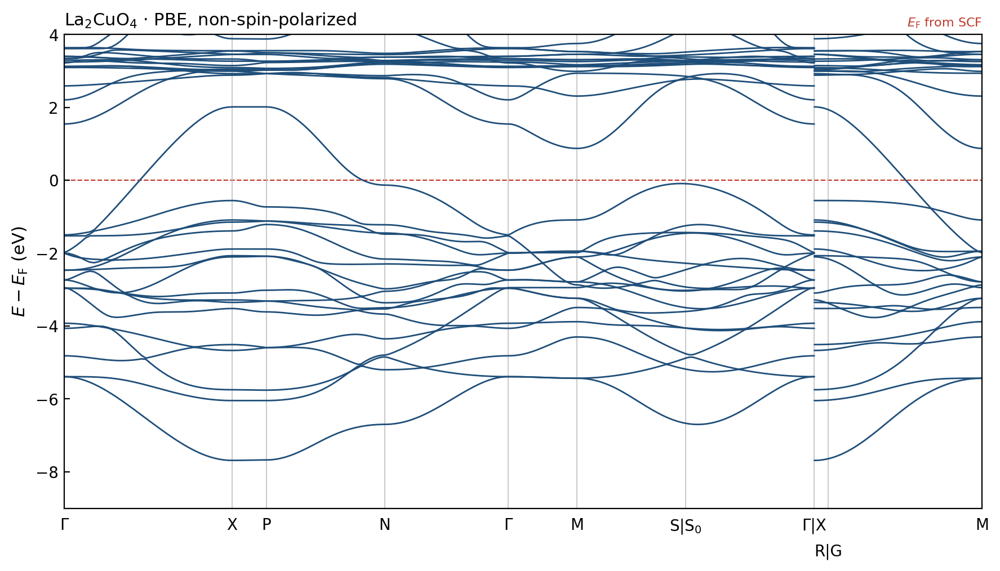
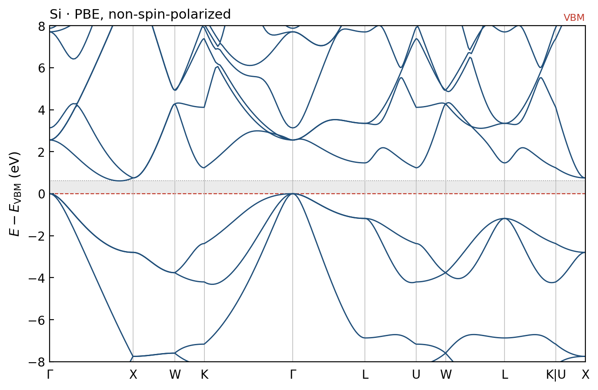

# 能带计算实例 / Band structure examples

来自本地保存的真实 VASP 结果。本次更新只核验并重绘已有数据，没有重新运行 VASP。

<a id="la2cuo4"></a>

## La₂CuO₄ · 非磁性 PBE / Nonmagnetic PBE



[能带 CSV / Band data](la2cuo4-bands.csv) · [计算摘要与来源哈希 / Summary and provenance](la2cuo4-summary.json)

| 项目 / Item | 数值 / Value |
| --- | --- |
| 体系 / Structure | La₂CuO₄ HTT，三维体相 / 3D bulk |
| 方法 / Method | 非磁性 PBE；无 SOC、DFT+U、杂化泛函 |
| VASP 版本 / Version | 5.4.4.18apr17-6-g9f103f2a35 |
| 路径采样 / Path samples | 360 k points, 64 bands, 1 spin channel |
| 路径 / Path | Hinuma: Γ–X–P–N–Γ–M–S \| S₀–Γ \| X–R \| G–M |
| 能量零点 / Energy zero | SCF Fermi energy = 8.11117014 eV |
| 路径结果 / Sampled-path result | 金属性 / metallic, gap = 0 eV |
| 绘图范围 / Plot window | −9 to 4 eV |

保存报告中的能带检查通过：本征值全部有限，最高能带在全部路径点为空。重绘前核验了能带 CSV、SCF 摘要、报告和物理模型与下载收据的 SHA-256。只调整图幅和拥挤标签的排版，保留原始 k 点位置、能量及路径断点。CSV 哈希：

```text
f0a333b075f6fde4c491d3d2a15fa38f95fe874feb597d5a61d00bb261136729
```

**模型边界：**此例展示非磁性 PBE 工作流的计算结果，不能据此描述 La₂CuO₄ 的反铁磁绝缘基态。磁性与强关联处理不在该次计算中。

This example uses an existing nonmagnetic PBE calculation, which is metallic on the sampled path. It does not model the antiferromagnetic insulating ground state of La₂CuO₄. The numerical CSV is unchanged; the plot preserves path distances and discontinuities. Closely spaced labels are staggered for readability.

<a id="silicon"></a>

## Si · PBE



这份图和 [si-bands.csv](si-bands.csv) 来自本地保存的真实 VASP Si 完整工作流结果，不是模拟曲线。本次发布只整理已有结果，没有重新运行 VASP。

| 项目 / Item | 数值 / Value |
| --- | --- |
| 材料 / Material | Si |
| 方法 / Method | PBE，非磁性 / nonmagnetic |
| VASP 版本 / Version | 5.4.4.18apr17-6-g9f103f2a35 |
| 路径采样 / Path samples | 400 k points, 16 bands, 1 spin channel |
| 采样路径带隙 / Sampled-path gap | 0.6104 eV，间接 / indirect |
| SCF Fermi energy | 5.92828368 eV |
| 绘图零点 / Plot reference | VBM = 5.6164 eV |

保存报告中的能带检查通过：本征值全部有限，最高能带在所有采样点为空。CSV 同时保留相对 SCF Fermi 能和绘图参考能的列，单位为 eV；路径距离单位为 Å⁻¹。

图以 `bands.csv`、SCF 结构和报告为依据，使用本项目的 `band_plot.replot_folder` 重绘；保留原始数值，重绘前核验本地下载收据中的 SHA-256。重绘不触发 VASP 计算。曲线数据文件的 SHA-256：

```text
89a695486fbef70a193c9fb9a0ae44ce4574a2c04ad3148be0aa83a13c72184a
```

This is an existing VASP silicon calculation, replotted with this project's plotting module after validating the local download receipt. The numerical CSV is unchanged. No VASP calculation was performed for this publication. The plotted energy zero is the VBM. The sampled path can miss global band extrema, and a PBE Kohn–Sham gap is not an experimental quasiparticle gap.
